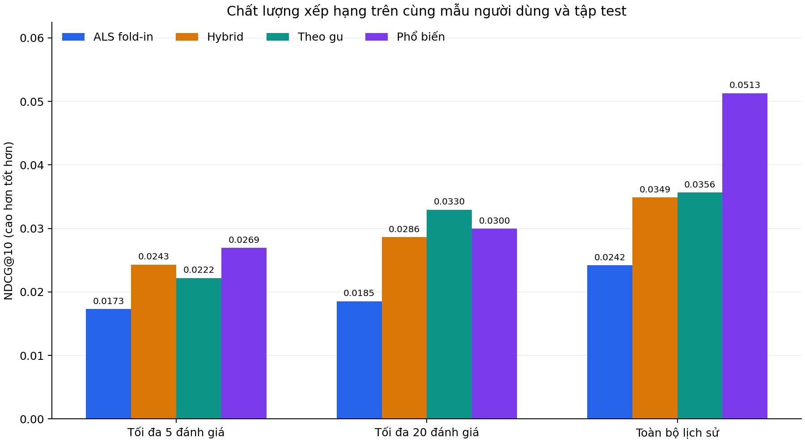
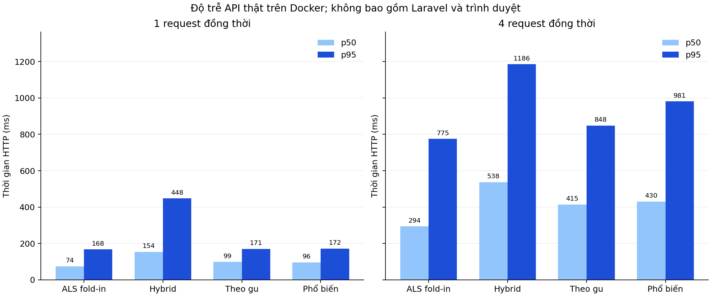

# Kết quả thực nghiệm bổ sung cho báo cáo MovieLab

Thời điểm hoàn tất quality: 20/10/2026 15:24:30 (UTC+7). Model: `als-4033f5cd6298`. Dataset: `ml-5b41ebbd9d02`.

## 1. Giao thức đánh giá chất lượng

- Lấy mẫu cố định 500 người dùng từ tập test bằng SHA256, seed=42.
- Dùng model gốc train-only. Kiểm tra SHA256 model và toàn bộ file split trước khi đo.
- Lịch sử chỉ lấy từ train + validation; ground truth là phim test được chấm từ 4 sao.
- Ba mức lịch sử: tối đa 5 đánh giá gần nhất, tối đa 20 đánh giá gần nhất và toàn bộ lịch sử trước test.
- Mỗi cách gợi ý dùng cùng 10507 phim ứng viên theo train; chỉ loại phim đã có trong lịch sử được cung cấp.
- Theo gu chọn thể loại từ đánh giá >3 sao như Laravel. Hybrid giữ trọng số 0,75, không chỉnh theo test.
- Phổ biến xếp theo số lượt đánh giá trong train; không dùng popularity.json toàn dataset để đánh giá chất lượng.
- Recall giữ toàn bộ positive test trong mẫu số, kể cả phim không có vector hoặc bị lọc thể loại.
- Danh sách rỗng/ngắn không bị bỏ khỏi kết quả. Người không có positive test được báo riêng.

## 2. Kết quả chất lượng Top 10

### Lịch sử last-5

Lịch sử thực tế: 5–5 đánh giá/người. Người có ít hơn ngưỡng dùng toàn bộ lịch sử sẵn có.

| Cách gợi ý | Người đánh giá | Precision@10 | Recall@10 | NDCG@10 | Độ dài TB | Tỷ lệ đủ 10 |
|---|---:|---:|---:|---:|---:|---:|
| ALS fold-in | 468 | 0.011325 | 0.023600 | 0.017315 | 10.00 | 100.00% |
| ALS + gu (Hybrid) | 468 | 0.014530 | 0.030429 | 0.024287 | 10.00 | 100.00% |
| Theo gu (lọc thể loại + ALS) | 468 | 0.014316 | 0.030006 | 0.022195 | 10.00 | 100.00% |
| Phổ biến (baseline) | 468 | 0.017521 | 0.037910 | 0.026925 | 10.00 | 100.00% |

Nhận xét: Phổ biến (baseline) có NDCG cao nhất trong mẫu và kịch bản này. Có 32 người không có positive test; không tính họ vào trung bình Precision/Recall/NDCG.

- ALS + gu (Hybrid) so với ALS fold-in: ΔNDCG=+0.006972; CI 95% [+0.000713, +0.013624]; khoảng không chứa 0 trong phép bootstrap này.
- Theo gu (lọc thể loại + ALS) so với ALS fold-in: ΔNDCG=+0.004880; CI 95% [-0.000439, +0.010516]; khoảng chứa 0, chưa đủ bằng chứng về hướng chênh lệch.
- Phổ biến (baseline) so với ALS fold-in: ΔNDCG=+0.009610; CI 95% [+0.001506, +0.018072]; khoảng không chứa 0 trong phép bootstrap này.

Khoảng tin cậy ghép cặp theo người dùng, 2.000 lần bootstrap; mang tính thăm dò, chưa hiệu chỉnh so sánh nhiều lần.

### Lịch sử last-20

Lịch sử thực tế: 18–20 đánh giá/người. Người có ít hơn ngưỡng dùng toàn bộ lịch sử sẵn có.

| Cách gợi ý | Người đánh giá | Precision@10 | Recall@10 | NDCG@10 | Độ dài TB | Tỷ lệ đủ 10 |
|---|---:|---:|---:|---:|---:|---:|
| ALS fold-in | 468 | 0.012179 | 0.025925 | 0.018537 | 10.00 | 100.00% |
| ALS + gu (Hybrid) | 468 | 0.016239 | 0.032717 | 0.028613 | 10.00 | 100.00% |
| Theo gu (lọc thể loại + ALS) | 468 | 0.020085 | 0.043224 | 0.032953 | 10.00 | 100.00% |
| Phổ biến (baseline) | 468 | 0.018376 | 0.042254 | 0.029967 | 10.00 | 100.00% |

Nhận xét: Theo gu (lọc thể loại + ALS) có NDCG cao nhất trong mẫu và kịch bản này. Có 32 người không có positive test; không tính họ vào trung bình Precision/Recall/NDCG.

- ALS + gu (Hybrid) so với ALS fold-in: ΔNDCG=+0.010075; CI 95% [+0.003788, +0.016919]; khoảng không chứa 0 trong phép bootstrap này.
- Theo gu (lọc thể loại + ALS) so với ALS fold-in: ΔNDCG=+0.014416; CI 95% [+0.008537, +0.021028]; khoảng không chứa 0 trong phép bootstrap này.
- Phổ biến (baseline) so với ALS fold-in: ΔNDCG=+0.011429; CI 95% [+0.003801, +0.019540]; khoảng không chứa 0 trong phép bootstrap này.

Khoảng tin cậy ghép cặp theo người dùng, 2.000 lần bootstrap; mang tính thăm dò, chưa hiệu chỉnh so sánh nhiều lần.

### Lịch sử full

Lịch sử thực tế: 18–2356 đánh giá/người. Người có ít hơn ngưỡng dùng toàn bộ lịch sử sẵn có.

| Cách gợi ý | Người đánh giá | Precision@10 | Recall@10 | NDCG@10 | Độ dài TB | Tỷ lệ đủ 10 |
|---|---:|---:|---:|---:|---:|---:|
| ALS fold-in | 468 | 0.017308 | 0.030220 | 0.024201 | 10.00 | 100.00% |
| ALS + gu (Hybrid) | 468 | 0.021795 | 0.039399 | 0.034895 | 10.00 | 100.00% |
| Theo gu (lọc thể loại + ALS) | 468 | 0.024145 | 0.040623 | 0.035640 | 10.00 | 100.00% |
| Phổ biến (baseline) | 468 | 0.033974 | 0.052902 | 0.051284 | 10.00 | 100.00% |

Nhận xét: Phổ biến (baseline) có NDCG cao nhất trong mẫu và kịch bản này. Có 32 người không có positive test; không tính họ vào trung bình Precision/Recall/NDCG.

- ALS + gu (Hybrid) so với ALS fold-in: ΔNDCG=+0.010694; CI 95% [+0.004116, +0.017374]; khoảng không chứa 0 trong phép bootstrap này.
- Theo gu (lọc thể loại + ALS) so với ALS fold-in: ΔNDCG=+0.011439; CI 95% [+0.005854, +0.017082]; khoảng không chứa 0 trong phép bootstrap này.
- Phổ biến (baseline) so với ALS fold-in: ΔNDCG=+0.027083; CI 95% [+0.016427, +0.037859]; khoảng không chứa 0 trong phép bootstrap này.

Khoảng tin cậy ghép cặp theo người dùng, 2.000 lần bootstrap; mang tính thăm dò, chưa hiệu chỉnh so sánh nhiều lần.

## 3. Sai số dự đoán sao của ALS fold-in

| Lịch sử | RMSE ALS | MAE ALS | RMSE trung bình phim | MAE trung bình phim | Cặp có dự đoán / tổng | Coverage |
|---|---:|---:|---:|---:|---:|---:|
| last-5 | 0.902992 | 0.687291 | 0.921457 | 0.704972 | 8514/8527 | 99.85% |
| last-20 | 0.837764 | 0.646167 | 0.921457 | 0.704972 | 8514/8527 | 99.85% |
| full | 0.809874 | 0.618733 | 0.921457 | 0.704972 | 8514/8527 | 99.85% |

Dùng điểm dự đoán chưa clip về 0,5–5 sao. Baseline được so trên đúng cùng cặp test.
Không gán RMSE/MAE cho điểm Hybrid hoặc điểm sau lọc thể loại vì đây là điểm xếp hạng, chưa được hiệu chỉnh thành sao.

## 4. Benchmark API thật

Dùng 50 hồ sơ từ kịch bản last-20; 50 request/cách/lượt; 3 lượt; 3 request làm nóng mỗi nhóm.
HTTP thật qua Docker tới FastAPI, MongoDB thật tách biệt, 1 API process. BLAS 1 luồng.
Thời gian client gồm HTTP, đọc lịch sử MongoDB, tính fold-in/ranking, JSON và kiểm tra response ở client.
Không bao gồm Laravel, session web, trình duyệt, ảnh poster, startup model hoặc HDFS/Alluxio.

| Đồng thời | Cách gợi ý | Request | Lỗi | p50 HTTP (ms) | p95 HTTP (ms) | Request thành công/giây |
|---:|---|---:|---:|---:|---:|---:|
| 1 | ALS fold-in | 150 | 0 | 74.43 | 167.68 | 11.28 |
| 1 | ALS + gu (Hybrid) | 150 | 0 | 154.02 | 448.21 | 5.16 |
| 1 | Theo gu (lọc thể loại + ALS) | 150 | 0 | 99.24 | 170.71 | 9.20 |
| 1 | Phổ biến (baseline) | 150 | 0 | 96.21 | 171.76 | 9.21 |
| 4 | ALS fold-in | 150 | 0 | 294.00 | 775.49 | 10.59 |
| 4 | ALS + gu (Hybrid) | 150 | 0 | 537.50 | 1185.53 | 6.15 |
| 4 | Theo gu (lọc thể loại + ALS) | 150 | 0 | 414.55 | 848.09 | 8.53 |
| 4 | Phổ biến (baseline) | 150 | 0 | 430.34 | 981.01 | 7.93 |

Môi trường: Docker 29.7.2, 8 CPU khả dụng trong Docker VM, RAM VM 7.64 GiB; API giới hạn 1.00 GiB. Đây không phải thông số RAM vật lý của host.

Nhận xét ở concurrency 1: ALS fold-in có p95 thấp nhất (167.68 ms); ALS + gu (Hybrid) cao nhất (448.21 ms). Đây là số đo đạt được trên môi trường hiện tại, không phải thứ tự tốc độ đảm bảo ở mọi máy.

Nhận xét ở concurrency 4: ALS fold-in có p95 thấp nhất (775.49 ms); ALS + gu (Hybrid) cao nhất (1185.53 ms). Đây là số đo đạt được trên môi trường hiện tại, không phải thứ tự tốc độ đảm bảo ở mọi máy.

p50/p95 tính trên request thành công của các lượt gộp lại. RPS là thông lượng đạt được ở tải thử, không phải công suất tối đa.
Các chế độ có thứ tự được trộn cố định mỗi lượt để giảm thiên lệch thứ tự. Xem api/groups.csv để đánh giá dao động giữa các lượt.
Popularity của API dùng gói phục vụ hiện tại (có toàn dữ liệu), chỉ dùng đo tốc độ. Bảng chất lượng phía trên dùng train-only để tránh leakage.

## 5. Liên hệ với benchmark HDFS/Alluxio đã có

| Đợt đo | Thời gian đọc H2 so H0 | Tổng đọc + train H2 so H0 |
|---|---:|---:|
| Một máy, 11/10/2026 | +13.53% | -1.93% |
| Hai máy, 12/10/2026 | -39.51% | -6.38% |

Giá trị âm là giảm thời gian, dương là tăng. Hai đợt đo khác ngày và điều kiện máy; không dùng để chứng minh hai máy luôn nhanh hơn một máy.
Alluxio hỗ trợ đường đọc dữ liệu Spark. Các request API từ vector trong RAM không đi qua HDFS/Alluxio.

## 6. Giới hạn và kết luận có thể sử dụng

- Đã bổ sung phép so sánh offline ghép cặp cho 4 cách gợi ý và đo tải HTTP thật cho cùng 4 chế độ.
- Đây là mô phỏng phản hồi ít/nhiều trên người dùng MovieLens; chưa phải đánh giá người dùng mới hoàn toàn vì item factors đã học từ train gốc.
- Khác mẫu và giao thức với bảng Spark ALS trước đây; không lấy chênh lệch hai bảng để tuyên bố model tăng chất lượng.
- Ground truth chỉ gồm các đánh giá quan sát được; phim chưa được chấm không đồng nghĩa người dùng không thích.
- Không kết luận gu thể loại tốt hơn chỉ vì danh sách nhìn hợp gu. Dùng bảng test và khoảng tin cậy để diễn giải.
- Chưa có đo toàn bộ đường Laravel/trình duyệt hoặc nghiên cứu mức hài lòng người dùng.

## 7. Bằng chứng và tái lập

- summary.json: giao thức, seed, cohort, kết quả và SHA256 nguồn.
- quality.csv: bảng chất lượng; per-user.jsonl: kết quả từng người/cách/kịch bản.
- api/requests.csv: từng request; api/groups.csv: từng lượt; api/latency.csv: bảng tổng hợp.
- serving-parity.json: 30 đối chiếu Top 10 giữa evaluator và HTTP thật, khớp hoàn toàn.
- environment.json: cấu hình Docker và phiên bản image của đợt đo (nếu chạy bằng script điều phối).
- scripts/run_report_experiments.ps1: tự build, đánh giá, đo API, tổng hợp và dừng stack riêng.

Bằng chứng gốc của đợt này: `experiments/recommendation-evaluation/report-20261020-v2`.
